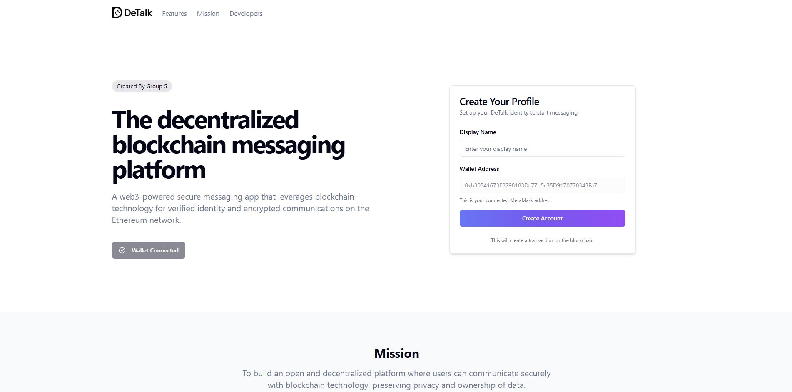
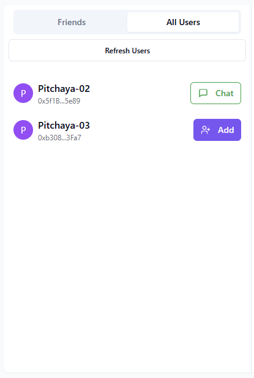
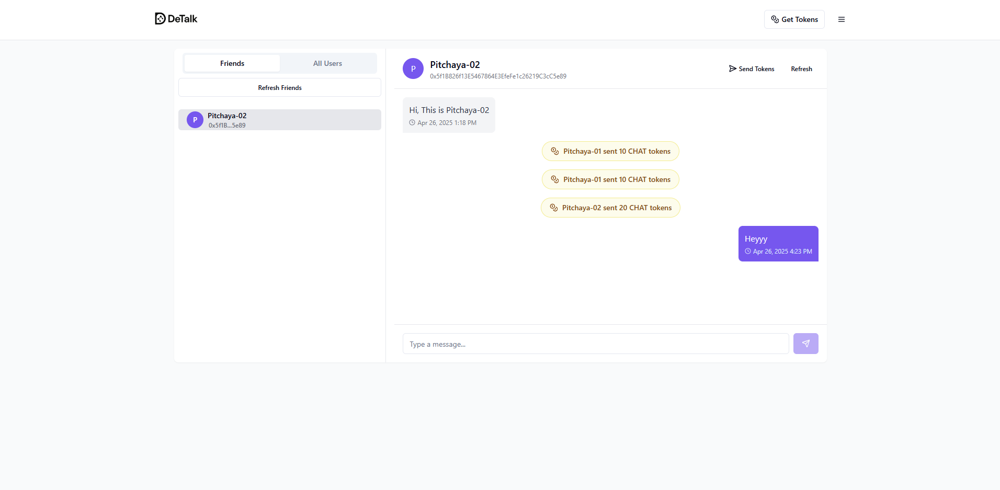
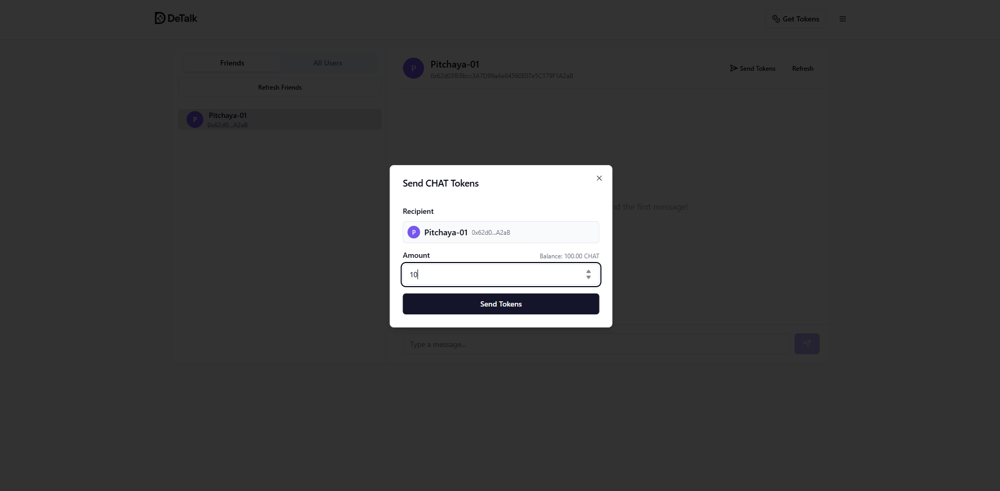

# DeTalk

DeTalk เป็นแอปแชทบนบล็อกเชนที่ทำเป็นโปรเจกต์กลุ่มที่มหาวิทยาลัย (demo เพื่อการศึกษา)

A small on-chain chat app. Users register with a wallet, add friends, and send messages that are stored in a smart contract. Each message costs a small fee paid in an ERC-20-style token (CHAT) issued by the project's own token contract. It was built as a university group project and is a learning demo, not a production messenger: every message is public on-chain.

## Status

- The original deployment was on the Holesky testnet, which has since been shut down. The hosted demo can no longer talk to a contract.
- The contracts in this repo have changed since that deployment (see [Contracts](#contracts)), so the old addresses are no longer used. To run the app you need to deploy your own copy, locally or on a live testnet such as Sepolia. Instructions are below.
- The contracts have not been audited.

## Screenshots

Screenshots from the original Holesky version are in [`docs/screenshots/`](docs/screenshots). Updated images for the current build still need to be added.

| | |
|---|---|
|  |  |
|  |  |

## Features

- Register with a wallet address and a display name; new users receive 100 CHAT
- Browse registered users and add friends
- Send messages to registered users (0.01 CHAT per message)
- Send CHAT to friends, recorded as a system message in the conversation
- Faucet: 10 CHAT per address every 24 hours
- Profile page with balance and transaction history built from contract events
- Light and dark theme

## Tech stack

- Frontend: Vite, React 18, TypeScript, Tailwind CSS, shadcn/ui (Radix), React Router, TanStack Query, ethers v5
- Contracts: Solidity 0.8.24, Hardhat, Mocha/Chai tests
- CI: GitHub Actions (lint, build, contract tests)

## Architecture

```
contracts/            Hardhat project
  contracts/          ChatContract.sol, TokenContract.sol
  test/               Contract tests
  scripts/            deploy.js, sync-abi.js
src/
  components/         UI components (components/ui is shadcn/ui)
  contexts/           Wallet/contract provider and theme provider
  config/             Contract addresses (from env), ABIs, chain id
  contracts/          ABI JSON generated from the Hardhat build
  pages/              Route components (lazy loaded)
  hooks/ lib/ types/
docs/screenshots/
```

**TokenContract** is a minimal ERC-20-style token (CHAT, 18 decimals) with an owner-gated `mint`, a 24 hour faucet (`requestTokens()`), and a `minter` address. Only the minter can call `requestTokens(address,uint256)`.

**ChatContract** stores users, friend lists and per-pair message history. `registerUser` mints the 100 CHAT sign-up bonus through the token's minter role, `sendMessage` pulls a 0.01 CHAT fee with `transferFrom`, and the owner can withdraw collected fees. Because `sendMessage` and `sendTokensToFriend` use `transferFrom`, the frontend calls `approve` on the token before each send.

The frontend talks to both contracts directly through ethers and a browser wallet (MetaMask). There is no backend.

## Run it locally

Requirements: Node 20+, MetaMask.

```bash
# 1. install
npm ci
npm --prefix contracts ci

# 2. start a local chain (keep running)
cd contracts && npx hardhat node

# 3. in a second terminal: deploy, then copy the printed addresses
cd contracts && npm run deploy:local

# 4. configure and start the frontend
cd ..
cp .env.example .env.local
# set VITE_CHAT_CONTRACT_ADDRESS, VITE_TOKEN_CONTRACT_ADDRESS and VITE_CHAIN_ID=31337
npm run dev
```

Open http://localhost:8080/Detalk-App/. In MetaMask, add the network `http://127.0.0.1:8545` with chain id `31337` and import one of the test private keys printed by `hardhat node`. These are well-known development keys; never use them on a real network.

### Deploying to Sepolia

```bash
cd contracts
export SEPOLIA_RPC_URL=<your rpc url>
export DEPLOYER_PRIVATE_KEY=<throwaway test wallet key>
npm run deploy:sepolia
```

Use a wallet that only holds testnet funds. The script deploys `TokenContract`, deploys `ChatContract`, and calls `setMinter` so the chat contract can mint the sign-up bonus. Put the printed addresses in `.env.local` with `VITE_CHAIN_ID=11155111`.

If you change a contract, run `npm --prefix contracts run compile` and `npm --prefix contracts run sync-abi` to refresh `src/contracts/*.json`.

## Tests and checks

```bash
npm run lint
npm run build
npm run test:contracts
```

The contract suite (29 tests) covers registration, friends, message fees and allowances, token transfers between friends, fee withdrawal, the faucet cooldown, the minter restriction and ownership transfer. There are no frontend tests.

## Contracts

Changes made after the original university submission:

- `requestTokens(address,uint256)` could be called by anyone, letting any account mint unlimited CHAT. It is now restricted to a `minter` that the owner sets (the ChatContract).
- `transferOwnership` had no access check in either contract; it is now `onlyOwner`.
- Compiler pinned to 0.8.24; empty names and messages are rejected.

Known limitations: messages are stored in plain text on-chain, `getAllUsers` is unbounded, and the transaction history only looks back about 10,000 blocks.

## Team

Computer Science project, group of three.

| Student ID | Name |
|---|---|
| 65051645 | พิชยะ หุตะจูฑะ (Pitchaya Hutajuta) |
| 65073814 | พิชญาภา บุญถนอม |
| 65054924 | ปิยย์กฤษณ์ วงศ์เกษมศักดิ์ |

## License

[MIT](LICENSE)
